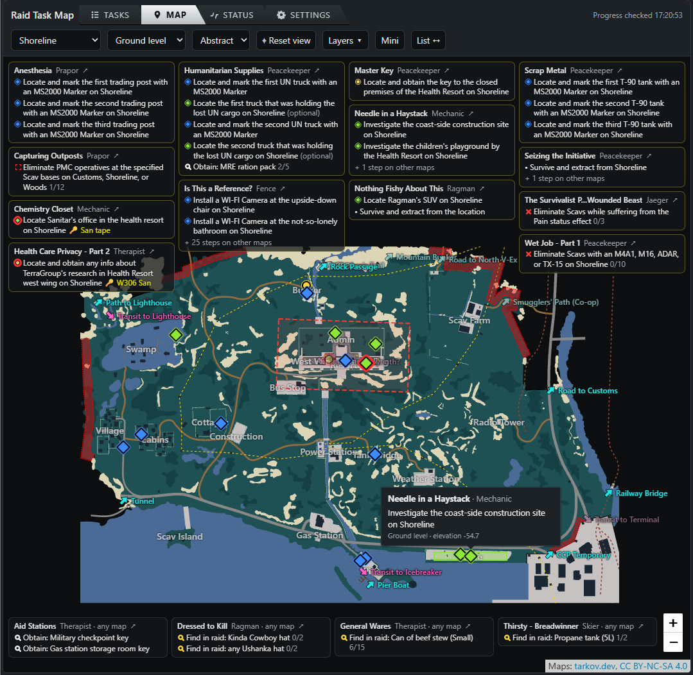
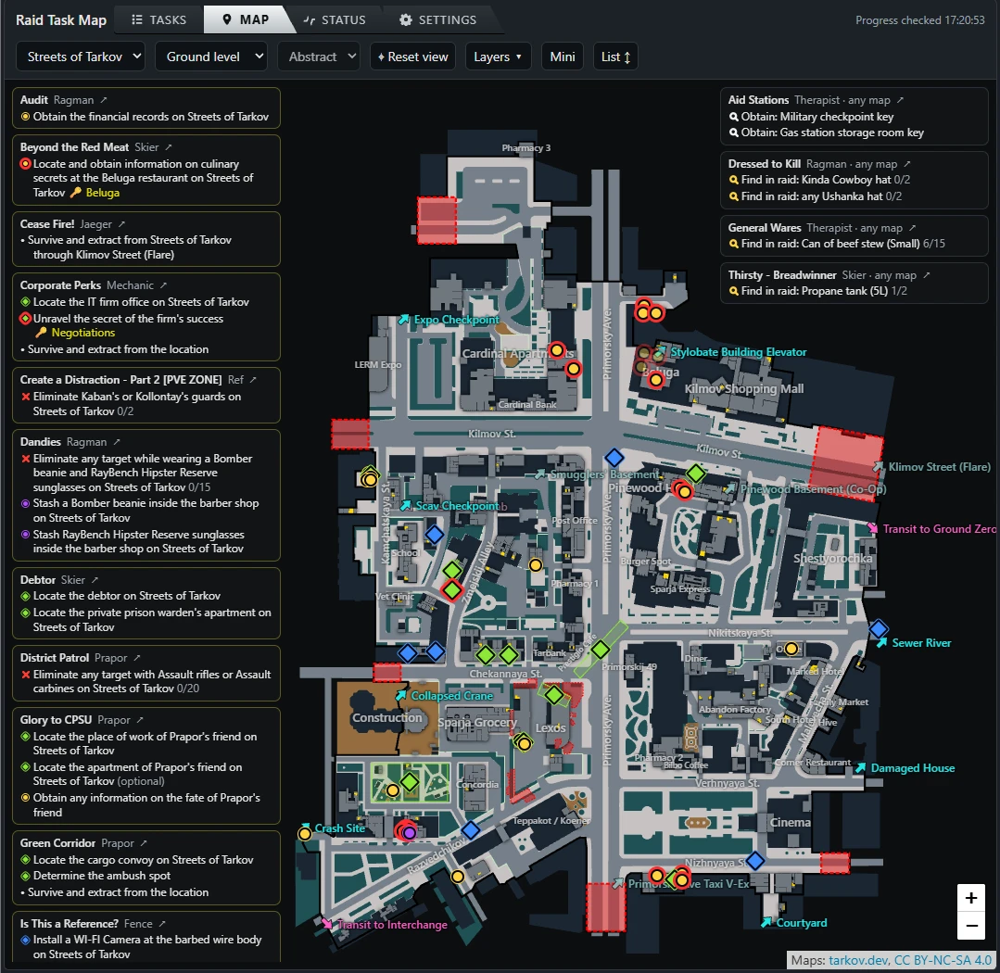
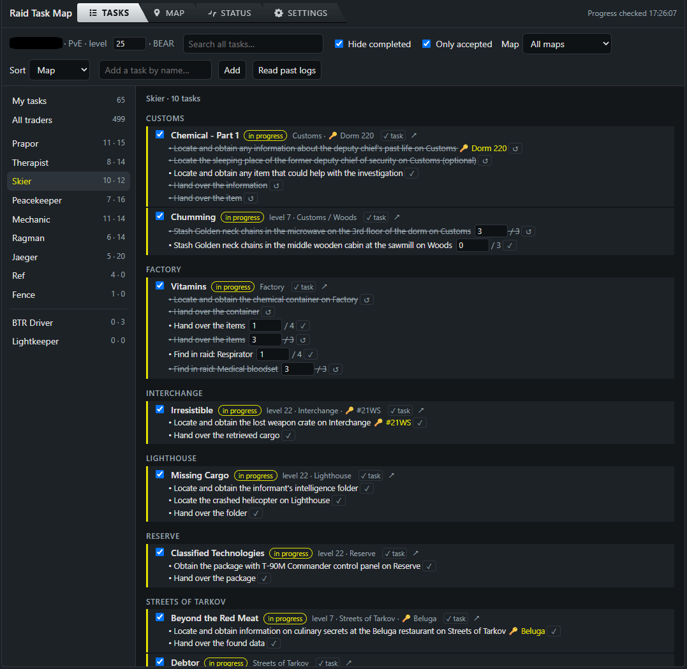

# Raid Task Map

A local companion for Escape from Tarkov. It shows your tasks, their locations, the
extracts and your position on a map.

It reads only the game's log files and the file names of your screenshots (the game
writes your position into them). It does not read game memory or network traffic, and
it does not change game files. The game's license agreement does not permit such tools.
Use the app at your own risk.

## Features

- **Tasks tab:** tick the tasks you have. "My tasks" lists them. Each trader shows its
  task lines and the state of each task: completed, in progress, available or locked.
- **Map tab:** objective zones, task-item locations, extracts and floors for the selected
  map. The mission list shows your ticked tasks for that map.
- **Position:** press the screenshot key in a raid. A blue arrow shows where you are and
  which way you look.
- **Game logs:** a task you accept is ticked; a task you complete or fail is unticked.
  When a raid loads, the app selects the map and the PMC or Scav extracts and starts a
  raid timer. After a transit it shows the next map and keeps the side (PMC or Scav).
  After the raid it goes back to the Tasks tab. Settings can turn off the
  map selection and the tab change.
- **TarkovTracker:** the app reads your progress from
  [TarkovTracker.org](https://tarkovtracker.org), so completed tasks and steps drop off
  your lists. If you allow it, it also sends task
  changes, step counts and your level.
- **Crafts tab:** the crafts of each hideout station and level, with the cost of the
  components, the value of the product, and the profit (value less cost), also per hour of
  craft time. Prices are flea
  market and trader prices from tarkov.dev for your game mode.
- **Story tab:** the chapters of the game's main story and their steps, from
  TarkovTracker.org, with a link to the Escape from Tarkov Wiki guide of each step. You
  mark the steps done or failed yourself. The tab has a **β** (beta) mark: the story data
  is incomplete and can have mistakes.
- **Settings tab:** your settings, and the state of TarkovTracker, game data, flea prices, story chapters,
  logs and screenshots, the changes that wait to be sent, and a list of what the app did.
- PvP and PvE have separate task lists.
- **Updates:** at start the app looks for a newer version on GitHub and asks before it
  installs it. Settings can turn this off or check now. A git clone is updated with
  `git`; a ZIP download gets the changed files. Your settings and task lists stay.

## Screenshots

Map tab on Shoreline. The mission list is across the top, and "any map" tasks are in the bottom row.



Map tab on Streets of Tarkov, with the mission list down the side.



Tasks tab: one trader's tasks, sorted by map, with step progress.



## Requirements

- Windows 10 or 11
- [Python 3.9 or later](https://www.python.org/downloads/). Tick "Add python.exe to
  PATH" during setup. No other packages are necessary.
- Optional: a TarkovTracker account. Without one, the app does not know what you have
  completed.

## Setup

1. Download or clone this repository.
2. In that folder, run `py raid_task_map.py`. The browser opens
   <http://localhost:3000>. Keep the terminal open while you play. Ctrl+C stops the app.
3. On tarkovtracker.org → Settings → API Tokens, create a token that can read progress.
   Paste it on the app's **Settings** tab and click **Save**.
4. Optional: tick **Send task progress to TarkovTracker** and click **Save**. The token
   then also needs "Write progress".
5. In the game (Settings → Controls), bind a key to **Screenshot**.
6. On the Tasks tab, tick your tasks, or click **Read past logs**.

A token is for one game mode (`PVP_` or `PVE_` prefix). To use both modes, save one
token, then save the other in the same box. While the game runs, the app uses the
game's mode; otherwise it uses **Game mode** on the Settings tab.

The app finds the `Logs` and screenshots folders automatically. If Settings shows one
as not found, type its path.

## Use

- **Tasks tab.** Click a task name to see its steps. Use search, filters and **Sort**.
  ↗ opens the wiki page.
- **Map tab.** Click a step that shows a map marker to move the map to it. Click a task
  name in the mission list to show only the name and hide its markers, and again to show
  them. **List ↔ / ↕ / ✕** puts
  the mission list across the top, down the side, or hides it. **Mini** (key **M**)
  shows only the map, extracts and task locations. **M** or **Esc** goes back. **Layers** sets PMC or Scav extracts and shows or
  hides objectives, extract names, landmark names, transits and locked doors. With **"Any map" tasks apart**
  (on by default), tasks for any map get their own column on the right (list down the side)
  or their own row at the bottom (list across the top).
- **Crafts tab.** Click a station button to hide or show its crafts. **Flea price** selects
  the 24-hour average or the lowest offer on the flea market (the in-game player market).
  A component costs the cheaper of the flea market and a trader; untick **Trader prices**
  to use only the flea market. A trader offer counts even if your trader level or tasks do
  not give you that offer yet. A tool (an item that the craft needs but gives back) costs nothing.
  The product value is the higher of the flea price less the fee for a flea market sale and
  the best trader price. The fuel that the hideout generator uses is not in the cost. The app keeps the prices for 8 hours;
  **↻ Download now** in the Flea prices row on the Settings tab gets new ones.
- **Story tab.** The column of icons on the left has one icon for each chapter, as in the
  game. Click an icon to show that chapter: its name, a count of done steps, its description
  and its steps. A green line under an icon shows the progress; a green corner shows a
  finished chapter. **↗** next to the chapter name opens its wiki page.
  - Click **✓** at the left of a step when you have done it, or **✕** when you failed it. A
    failed step is red and does not count. Click the same button again to remove the mark.
    The marks stay in this app and are not sent to TarkovTracker. Each game mode has its
    own marks.
  - The app cannot mark steps for you: the game logs do not show story progress.
  - The text on the right of a step, such as "Opens map Customs", tells which map or trader
    the step unlocks in the game. Clicking it does nothing.
  - Steps with an **Optional** label are under the step that they help with. They do not
    count.
  - Some chapters have a choice of two paths, labelled **path A** and **path B**. When you
    mark a step of one path, the other path goes grey and does not count. Remove the mark to
    get the other path back.
  - **↗** at the right end of a step opens its wiki section. If the app finds no matching
    section, it opens the chapter page.
  - The search box above the chapters shows the first chapter with a matching step and dims
    the icons of chapters with no match.
  - **Ending routes.** The last chapter, The Ticket, ends in one of four endings: Survivor,
    Savior, Debtor or Fallen. TarkovTracker lists the steps of only one of them (Savior), so
    the app also has the four routes, written by hand from the Story Endings flowchart on the
    wiki.
    Click a route button above the steps to see that route, or **All steps** to see the
    TarkovTracker list. A route has sections in the order you play them, with notes at the
    decisions. A step can have these labels:
    - **If:** followed by a condition: the step applies only in that case and does not count.
    - **Choice**: keep the armored case (found in the chapter Falling Skies) or hand it over
      to Prapor. When you mark one, the other choice and the steps for it go grey.
    - **Mandatory**: the route cannot finish without it.
    - **🏆**: the achievement that the step gives.

    Many route steps are also TarkovTracker steps; a mark on one shows on both.
  - The app downloads the chapters when you first open the tab and keeps them for a day.
    **↻ Download now** in the Story chapters row on the Settings tab downloads them at once.
- **Progress** (with sending on). Type a step count, mark a step or task done with
  **✓**, undo with **↺**. On the Map tab, mission cards have **−**, **+** and **✓** for each
  step. Type your level in the box next to your name; the game logs
  do not give it.

Map markers:

| Marker | Meaning |
| --- | --- |
| Green diamond | Objective zone |
| Blue diamond | Objective zone where you place, mark with or use a special-slot item (marker, signal jammer, WI-FI camera, multitool, flare) |
| Red dashed outline | Area where you kill targets. Point at the outline to see the step |
| Purple dot | Spot where you stash an item |
| Golden dot | Possible task-item location |
| Red ring | The step needs a key |
| Cyan ↗ arrow | PMC extract. A shared PMC and Scav extract is cyan too, except in a Scav raid |
| Light blue ↗ arrow | Scav extract, and a shared extract in a Scav raid |
| Pink ↘ arrow | Transit to another map |
| Pale arrow | Extract or transit with a requirement (payment, key, no backpack, Red Rebel and paracord, partner, other condition). Point at it to see what it needs |
| Red ✕ (mission list) | Kill step with no area on the map |
| White or gold magnifier (mission list) | Item to obtain; gold: the item must be found in raid |
| Orange key | Locked door or car trunk (Layers → Locked doors). Bigger: a ticked task needs its key |
| 🔑 | Key that a task or step needs |

## Troubleshooting

| Problem | Fix |
| --- | --- |
| `py` is not recognized | Install Python (see Requirements). |
| "Could not start on port 3000" | Run `py raid_task_map.py --port 3005`. |
| The marker does not move | Check that Settings finds the screenshots folder (usually `Documents\Escape From Tarkov\Screenshots`) and that the Map tab shows your map. |
| The map does not change when a raid loads | Check that Settings finds the logs folder and that "Select the map when a raid loads" is ticked. |
| "Read past logs" proposes completed tasks | The game deletes old logs. Tasks that TarkovTracker shows as completed are left out; untick the others. |
| "TarkovTracker daily write limit reached" | A free account can send 100 changes a day. The app sends the rest after 00:00 UTC. |
| "TarkovTracker answered 401" | The token is wrong, revoked or for the other game mode. |
| The Crafts tab shows "?" for a profit | The craft uses or makes an item with no price, such as a task item. The app cannot calculate that profit. |
| The Flea prices row shows "Old prices" | tarkov.dev did not answer. The app uses the saved prices. Click **↻ Download now** again after some minutes. |
| The Story tab cannot load the chapters | TarkovTracker.org did not answer. Click **↻ Download now** in the Story chapters row after some minutes. |
| A step's **↗** opens the wrong wiki section | The app finds a section by its words, and some wiki headings use other words. Use the **↗** next to the chapter name. |

## Privacy

- The app listens only on `127.0.0.1` and refuses requests from other sites.
- Tokens are in `config.json` in plain text. Do not share it. Git ignores it.
- Ticked tasks, story marks and unsent changes are in `state.json`.
- The app contacts only `tarkov.dev`, `unpkg.com` (Leaflet), `api.tarkovtracker.org`
  (with your token), `tarkovtracker.org` (story chapters and icons, no token),
  `escapefromtarkov.fandom.com` (wiki section names, no token) and `github.com` (update
  check; off in Settings).
- Screenshots are deleted only if you tick that option in Settings (off by default).

## Development

```
py -3 raid_task_map.py --no-browser      start without opening the browser
py -3 raid_task_map.py --no-update       start without the update check
py -3 -m unittest discover tests         server and log-reader tests
cd tests; npm install; npm test          page tests (Node.js and jsdom)
```

| File | Purpose |
| --- | --- |
| `raid_task_map.py` | Local server: page, TarkovTracker proxy, screenshot and log watchers |
| `game_logs.py` | Game log reader and raid state |
| `updater.py` | Update check and update from GitHub |
| `crafts.py` | Crafts and prices from tarkov.dev, saved in `cache/` for 8 hours |
| `story.py` | Story chapters from TarkovTracker.org with wiki links, saved in `cache/` for a day |
| `story_routes.json` | The four ending routes of The Ticket, written by hand from the Story Endings flowchart |
| `index.html` | The page: map, task lists, crafts, story, settings |
| `maps.json` | Map projection settings, from tarkov.dev |
| `config.json`, `state.json` | Your settings and task lists. Made by the app; git ignores them |
| `cache/` | Saved crafts, prices and story chapters. Made by the app; git ignores it |
| `tests/fixtures` | Log lines from a real game session, IDs and addresses masked |

## Credits and licenses

- License: [GPL-3.0](LICENSE).
- Log patterns and raid state logic are ported from
  [TarkovMonitor](https://github.com/the-hideout/TarkovMonitor) (GPL-3.0).
- Maps: [tarkov.dev](https://tarkov.dev) and their authors, mainly Shebuka, under
  [CC BY-NC-SA 4.0](https://creativecommons.org/licenses/by-nc-sa/4.0/). They are loaded
  at run time; none are in this repository. Their license forbids commercial use and
  use in cheat software.
- Game data: the [tarkov.dev](https://tarkov.dev) API. `maps.json` is from the
  tarkov-dev project (MIT).
- Task progress, story chapters and chapter icons: [TarkovTracker.org](https://tarkovtracker.org).
  The icons are loaded from their site at run time; none are in this repository.
- Story guides: the [Escape from Tarkov Wiki](https://escapefromtarkov.fandom.com). The app
  links to it and reads only its section names.
- Ending routes: the [Story Endings flowchart](https://escapefromtarkov.fandom.com/wiki/Endings)
  by Callsign_Smokey (Kay08x), version 1.7.6. `story_routes.json` describes its routes in
  text; the image is not in this repository.
- Map library: [Leaflet](https://leafletjs.com) (BSD 2-Clause), loaded from unpkg.com.

This project is not affiliated with or approved by Battlestate Games. Escape from
Tarkov is a trademark of Battlestate Games Limited.
